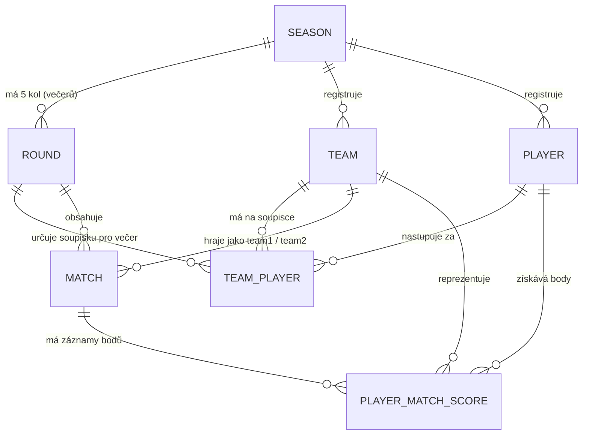

# SPPDF BeerPong Liga – Architektura & Doménový model

Tento dokument sjednocuje a definuje doménový model, strukturu databáze, pravidla výpočtů a uživatelské rozhraní pro BeerPong ligu.

---

## 1. Základní koncept a pojmy

Liga je navržena pro reálné použití na univerzitě / v klubu podle následujících principů:

### 1.1 Sezóna (Season / Semestr)
- Odpovídá **jednomu akademickému semestru** (např. *Jarní semestr 2025*, *Podzimní semestr 2024*).
- V jeden okamžik běží **pouze jedna aktivní sezóna** (`is_active = true`).
- Minulé sezóny slouží jako **historický archiv**, do kterého lze kdykoliv nahlížet a procházet kompletní výsledky i statistiky minulých semestrů.
- V rámci sezóny jsou registrovány týmy a hráči.

### 1.2 Kolo (Round / Turnajový večer)
- V rámci jednoho semestru se typicky odehraje **přesně 5 kol** (1. Kolo až 5. Kolo).
- **Kolo = 1 turnajový večer**, kdy se týmy a hráči sejdou k odehrání zápasů.
- **5. kolo je tradičně Velké Finále** celého semestru.
- Každé kolo má své datum konání, pořadové číslo (1–5) a stav (plánováno / odehráno).
- V modelu **neexistuje zbytečný mezistupeň „Turnaj“** – turnajem je samotný večer (Kolo).

### 1.3 Tým (Team)
- Tým je perzistentní v rámci celé sezóny (semestru).
- Název týmu je v rámci dané sezóny unikátní.
- Tým nemá v databázi pevně zadrátované hráče – soupiska se tvoří flexibilně pro každý večer.

### 1.4 Hráč (Player)
- Hráč je registrován pro danou sezónu (jméno unikátní v rámci semestru).
- Hráč existuje nezávisle na týmech.

### 1.5 Soupisky kola (TeamPlayer)
- Určuje, za jaký tým hráč nastoupí v konkrétním **kole (večeru)**.
- **Dynamické přestupy:** Hráč může v 1. kole hrát za Tým A a ve 2. kole nastoupit za Tým B.
- Tým může mít v kole libovolný počet hráčů (typicky 2, ale klidně 1 nebo 3).
- Omezení: V rámci jednoho turnajového večera smí hráč nastoupit pouze za jeden tým (`UNIQUE(round_id, player_id)`).

### 1.6 Zápas (Match)
- Zápas mezi dvěma týmy (`team1_id` vs `team2_id`) odehraný v rámci konkrétního kola (`round_id`).
- Zaznamenává konečný výsledek (např. 10 : 7).

### 1.7 Individuální skóre zápasu (PlayerMatchScore)
- Záznam o výkonu konkrétního hráče v daném zápase:
  - **Trefené kelímky (`score`)** – kelímky trefené hráčem (ofenziva).
  - **Blowjoby (`blowjobs`)** – úspěšně vyfouknuté kelímky před dopadem (defenziva).
- Vazba na hráče, zápas a tým, za který v daném zápase hrál.

---

## 2. Výpočet tabulek a statistik

### 2.1 Bodování týmů
- **Výhra:** 3 body
- **Remíza:** 1 bod
- **Prohra:** 0 bodů
- **Kritéria pořadí v tabulce:**
  1. Počet bodů
  2. Rozdíl skóre (trefené kelímky minus obdržené kelímky)
  3. Vyšší počet trefených kelímků

### 2.2 Úrovně statistik
1. **Statistiky turnajového večera (Kola):**
   - *Tabulka večera:* Výsledky a body týmů získané v daném kole.
   - *Král střelců večera:* Hráč s nejvíce kelímky za daný večer.
   - *BlowJob King večera:* Hráč s nejvíce vyfouknutými kelímky za večer.
2. **Celkové statistiky semestru (Sezóny):**
   - *Celková ligová tabulka:* Součet bodů a skóre týmů za všech 5 večerů semestru.
   - *Král střelců semestru:* Celkový počet kelímků hráče napříč všemi koly (i pokud střídal týmy!).
   - *BlowJob King semestru:* Celkový počet vyfouknutých kelímků za celý semestr.

---

## 3. Databázové schéma (Drizzle ORM)

